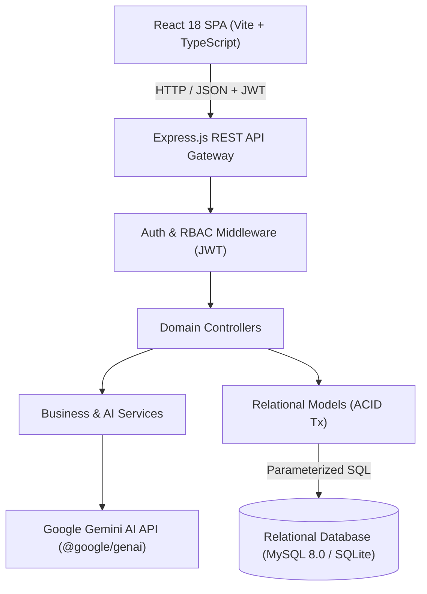
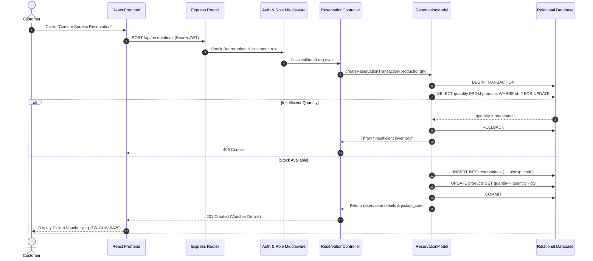

# 🏛️ ZeroWaste Market — System Architecture & Design

This document details the architectural decisions, design patterns, data flow mechanisms, and security considerations underpinning **ZeroWaste Market**.

---

## 1. High-Level System Architecture

ZeroWaste Market follows a **Layered Monolithic Architecture (Service-Oriented Inside)** with a decoupled Single Page Application (SPA) frontend.



### Architectural Decisions

1. **Decoupled Client & Server:**
   - The frontend is built with **React 18, TypeScript, and Vite**, providing instant HMR and static build optimization.
   - The backend runs on **Node.js and Express**, communicating exclusively via standard JSON REST endpoints.
   - Decoupling enables independent deployment, automated headless testing, and potential native mobile app expansion without backend modifications.

2. **Adaptive Dual-Mode Database Engine:**
   - The primary database engine uses **MySQL 8.0+** via `mysql2/promise`.
   - To guarantee zero-friction onboarding, sandboxed CI/CD, and offline hackathon presentation resilience, `src/config/database.js` features an automated fallback to an embedded **SQLite engine** with identical table schemas, parameterized queries, and ACID transactions.

3. **Server-Side AI Isolation:**
   - Direct client access to Google Gemini is strictly disallowed.
   - The server maintains the `GEMINI_API_KEY`, enforces token limits, validates AI JSON outputs, and falls back to a heuristic rule-based engine when offline.

---

## 2. Directory Layout & Module Responsibilities

```text
server/src/
├── config/
│   ├── database.js          # Unified DB connector (MySQL pool + SQLite fallback)
│   └── gemini.js            # Google Gen AI SDK initialization & capability check
├── controllers/
│   ├── auth.controller.js   # Handles registration, password hashing, and token issuance
│   ├── product.controller.js# Surplus product CRUD and locality search
│   ├── reservation.controller.js # Transactional reservations and handover lifecycle
│   ├── donation.controller.js   # NGO donation listings and claim workflows
│   ├── ai.controller.js     # Image analysis and listing quality checker
│   ├── dashboard.controller.js  # Role-specific analytics and global impact
│   └── user.controller.js   # User notifications and profile settings
├── middleware/
│   ├── auth.middleware.js   # JWT extraction and verification
│   ├── role.middleware.js   # Role-Based Access Control (RBAC)
│   ├── upload.middleware.js # Multer file upload validation (5MB, JPEG/PNG/WebP)
│   └── error.middleware.js  # Global error trap and 404 handler
├── models/
│   ├── user.model.js        # User, seller profile, and NGO profile queries
│   ├── product.model.js     # Product queries and stock updates
│   ├── reservation.model.js # Transactional reservations and cancellation restoration
│   ├── donation.model.js    # NGO surplus listings and claims
│   └── notification.model.js# Event notification log
├── services/
│   ├── gemini.service.js    # AI prompt engineering, Gemini API call, heuristic fallback
│   └── impact.service.js    # Mathematical calculation of CO2e, water, and waste avoided
└── utils/
    ├── response.js          # Standardized API response format
    └── validators.js        # Input validation logic
```

---

## 3. Data Flow & Request Lifecycle



---

## 4. Key Module Explanations (For Learning Developers)

### A. Database Transaction Engine (`reservation.model.js`)
* **What it does:** Executes reservation creation and inventory deduction within a single atomic database transaction.
* **Why it is required:** If two customers attempt to reserve the last sourdough loaf simultaneously, a race condition could cause negative inventory (overselling).
* **How it works:**
  1. Requests a dedicated connection from the connection pool (`const conn = await db.getConnection()`).
  2. Begins transaction (`await conn.beginTransaction()`).
  3. Executes `SELECT ... FOR UPDATE` (or atomic check) to lock the product record.
  4. Generates an encrypted 8-character pickup code (`ZW-GUW-XXXX`).
  5. Inserts reservation record and deducts inventory.
  6. Calls `conn.commit()`. If an error occurs, triggers `conn.rollback()`.
  7. Always releases connection back to the pool in a `finally` block.

### B. Gemini AI Listing Assistant (`gemini.service.js`)
* **What it does:** Accepts seller notes, category hints, and optional product photographs, returning structured JSON recommendations.
* **Why it is required:** Sellers often lack time to write descriptive copy or compute optimal clearance markdowns at closing time.
* **Prompt Engineering Strategy:**
  - Instructs Gemini with a system prompt specifying strict JSON output schema.
  - Formulates a hard compliance constraint: **"AI MUST NOT independently certify product safety or authenticity."**
  - Includes a pre-flight heuristic assistant fallback that operates offline without API keys.

### C. Role-Based Access Control (`role.middleware.js`)
* **What it does:** Inspects the decoded JWT attached to `req.user` and verifies if the user's role matches the required permission set (`seller`, `customer`, or `ngo`).
* **Why it is required:** Frontend route guards can be bypassed by manual HTTP requests. Security must be enforced on the server.
* **How it handles violations:** Immediately terminates request pipeline with HTTP 403 Forbidden without touching controllers or databases.

---

## 5. Security Architecture

1. **Password Hashing:** Passwords are never stored in plain text. Stored using `bcryptjs` with 10 salt rounds.
2. **JWT Session Management:** Stateless authentication with 7-day expiration. Secret stored strictly in backend environment variables.
3. **SQL Injection Defense:** 100% of SQL statements across all models use parameterized placeholders (`?`). No string concatenation is used for user inputs.
4. **File Upload Hardening:** `Multer` middleware restricts uploads to images (`image/jpeg`, `image/png`, `image/webp`) with a hard 5MB limit. Filenames are randomized with timestamps and random integers to prevent directory traversal.
5. **Rate Limiting:** Protects sensitive endpoints (`/api/auth/login`, `/api/auth/register`) from brute-force attempts via `express-rate-limit`.
