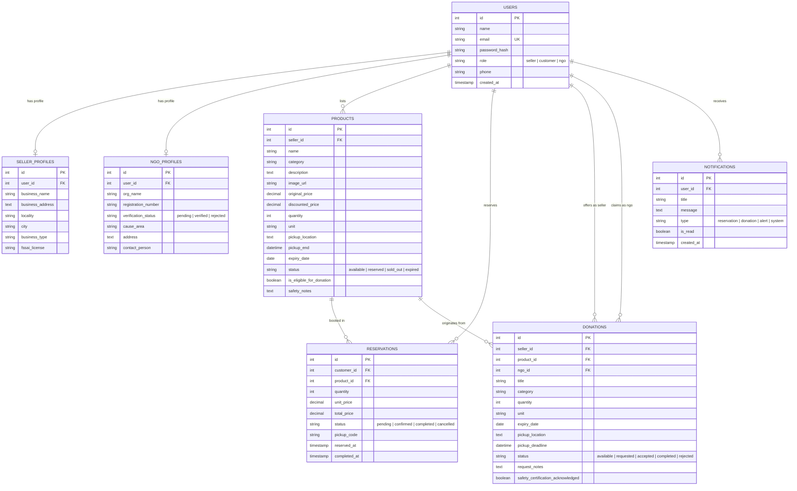

# 🗄️ ZeroWaste Market — Relational Database Schema

ZeroWaste Market implements a relational schema designed for MySQL 8.0+ and compatible with SQLite 3.

---

## 1. Entity Relationship Diagram (ERD)

---

## 2. Table Specifications

### 1. `users`
Core user identity credentials and platform roles.
* `id` INT AUTO_INCREMENT PRIMARY KEY
* `name` VARCHAR(100) NOT NULL
* `email` VARCHAR(150) NOT NULL UNIQUE
* `password_hash` VARCHAR(255) NOT NULL (bcrypt hashed)
* `role` ENUM('seller', 'customer', 'ngo') NOT NULL
* `phone` VARCHAR(20)
* `created_at` TIMESTAMP DEFAULT CURRENT_TIMESTAMP
* **Indexes:** `idx_users_email`, `idx_users_role`

### 2. `seller_profiles`
Commercial establishment information and food licensing credentials.
* `id` INT AUTO_INCREMENT PRIMARY KEY
* `user_id` INT NOT NULL UNIQUE (FK -> `users.id` ON DELETE CASCADE)
* `business_name` VARCHAR(150) NOT NULL
* `business_address` TEXT NOT NULL
* `locality` VARCHAR(100) NOT NULL (e.g. 'Christian Basti', 'GS Road')
* `city` VARCHAR(50) DEFAULT 'Guwahati'
* `state` VARCHAR(50) DEFAULT 'Assam'
* `pin_code` VARCHAR(10) DEFAULT '781005'
* `business_type` VARCHAR(50) NOT NULL
* `fssai_license` VARCHAR(50)
* **Indexes:** `idx_seller_locality`

### 3. `ngo_profiles`
Non-profit verification records.
* `id` INT AUTO_INCREMENT PRIMARY KEY
* `user_id` INT NOT NULL UNIQUE (FK -> `users.id` ON DELETE CASCADE)
* `org_name` VARCHAR(150) NOT NULL
* `registration_number` VARCHAR(100) NOT NULL
* `verification_status` ENUM('pending', 'verified', 'rejected') DEFAULT 'pending'
* `cause_area` VARCHAR(100) NOT NULL
* `address` TEXT NOT NULL
* `contact_person` VARCHAR(100) NOT NULL
* **Indexes:** `idx_ngo_verification`

### 4. `products`
Surplus inventory listings published by local businesses.
* `id` INT AUTO_INCREMENT PRIMARY KEY
* `seller_id` INT NOT NULL (FK -> `users.id` ON DELETE CASCADE)
* `name` VARCHAR(150) NOT NULL
* `category` VARCHAR(50) NOT NULL
* `description` TEXT
* `image_url` VARCHAR(500)
* `original_price` DECIMAL(10, 2) NOT NULL
* `discounted_price` DECIMAL(10, 2) NOT NULL
* `quantity` INT NOT NULL
* `unit` VARCHAR(20) DEFAULT 'item'
* `pickup_location` TEXT NOT NULL
* `pickup_start` DATETIME
* `pickup_end` DATETIME NOT NULL (availability deadline)
* `expiry_date` DATE
* `status` ENUM('available', 'reserved', 'sold_out', 'expired') DEFAULT 'available'
* `is_eligible_for_donation` BOOLEAN DEFAULT FALSE
* `safety_notes` TEXT
* **Indexes:** `idx_product_seller`, `idx_product_category`, `idx_product_status`, `idx_product_pickup_end`

### 5. `reservations`
Customer vouchers and transaction logs.
* `id` INT AUTO_INCREMENT PRIMARY KEY
* `customer_id` INT NOT NULL (FK -> `users.id` ON DELETE CASCADE)
* `product_id` INT NOT NULL (FK -> `products.id` ON DELETE CASCADE)
* `quantity` INT NOT NULL
* `unit_price` DECIMAL(10, 2) NOT NULL
* `total_price` DECIMAL(10, 2) NOT NULL
* `status` ENUM('pending', 'confirmed', 'completed', 'cancelled') DEFAULT 'pending'
* `pickup_code` VARCHAR(30) NOT NULL (e.g. `ZW-GUW-8A29`)
* `reserved_at` TIMESTAMP DEFAULT CURRENT_TIMESTAMP
* `completed_at` TIMESTAMP NULL
* `notes` TEXT
* **Indexes:** `idx_reservation_customer`, `idx_reservation_product`, `idx_reservation_status`

### 6. `donations`
Surplus listings channeled directly to verified NGOs.
* `id` INT AUTO_INCREMENT PRIMARY KEY
* `seller_id` INT NOT NULL (FK -> `users.id` ON DELETE CASCADE)
* `product_id` INT NULL (FK -> `products.id` ON DELETE SET NULL)
* `ngo_id` INT NULL (FK -> `users.id` ON DELETE SET NULL)
* `title` VARCHAR(150) NOT NULL
* `category` VARCHAR(50) NOT NULL
* `description` TEXT
* `quantity` INT NOT NULL
* `unit` VARCHAR(20) DEFAULT 'pack'
* `expiry_date` DATE NOT NULL
* `pickup_location` TEXT NOT NULL
* `pickup_deadline` DATETIME NOT NULL
* `status` ENUM('available', 'requested', 'accepted', 'completed', 'rejected', 'cancelled') DEFAULT 'available'
* `request_notes` TEXT
* `safety_certification_acknowledged` BOOLEAN DEFAULT TRUE
* **Indexes:** `idx_donation_seller`, `idx_donation_ngo`, `idx_donation_status`

### 7. `notifications`
Real-time user notification logs.
* `id` INT AUTO_INCREMENT PRIMARY KEY
* `user_id` INT NOT NULL (FK -> `users.id` ON DELETE CASCADE)
* `title` VARCHAR(150) NOT NULL
* `message` TEXT NOT NULL
* `type` ENUM('reservation', 'donation', 'alert', 'system') DEFAULT 'system'
* `is_read` BOOLEAN DEFAULT FALSE
* `created_at` TIMESTAMP DEFAULT CURRENT_TIMESTAMP
* **Indexes:** `idx_notification_user`
