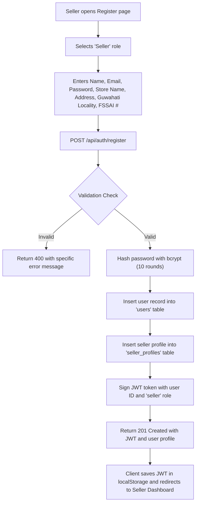
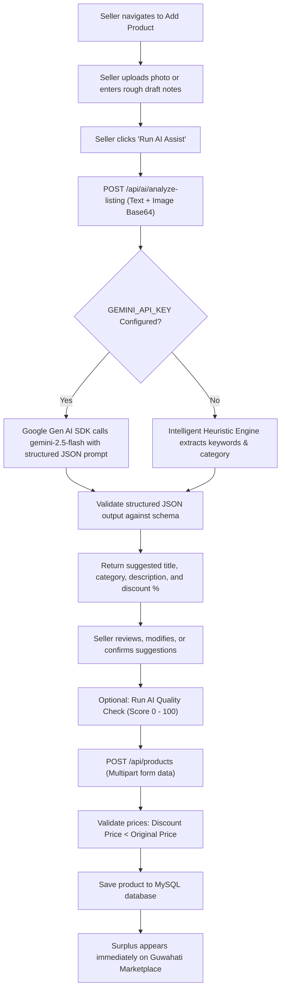
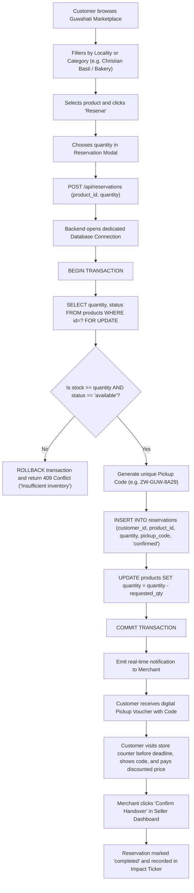
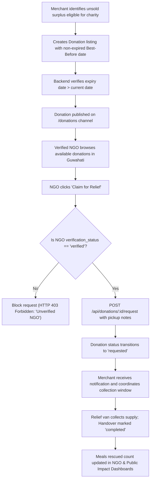
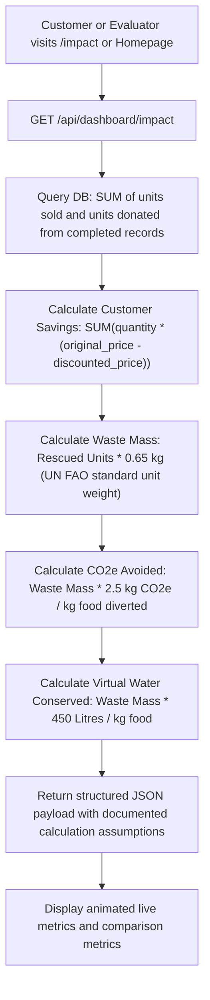

# 🔄 ZeroWaste Market — Complete Workflow Specifications

This document defines the 5 primary end-to-end operational workflows implemented in ZeroWaste Market.

---

## WORKFLOW A: Seller Registration & Onboarding

### Edge Cases Handled:
- **Duplicate Email:** Checked against existing records. Returns HTTP 409 Conflict with helpful message.
- **Short Password:** Enforces minimum 6 characters.
- **Missing Business Details:** Requires business name and address before assigning `seller` role.

---

## WORKFLOW B: Add Surplus Product with Gemini AI Listing Assistant

### Safety & Compliance Guardrail:
- **Food Safety Isolation:** Gemini AI is programmatically instructed **never** to certify food safety or microbiological soundness. The seller must independently inspect physical condition before publication.

---

## WORKFLOW C: Customer Reservation & Transactional Stock Lock

---

## WORKFLOW D: NGO Surplus Food Relief Claim

---

## WORKFLOW E: Live Environmental & Financial Impact Tracking

